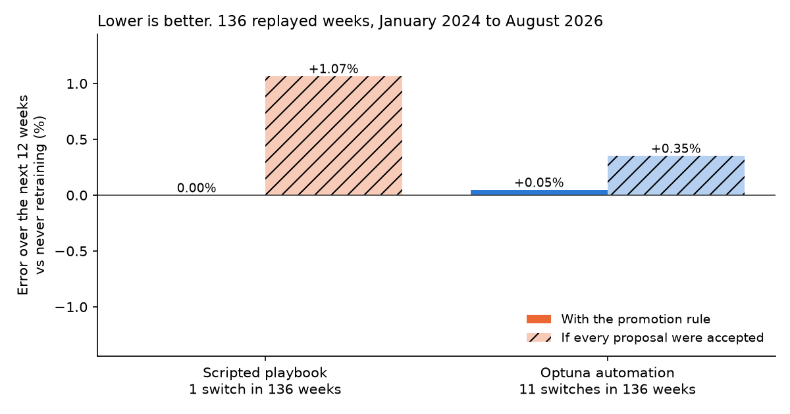
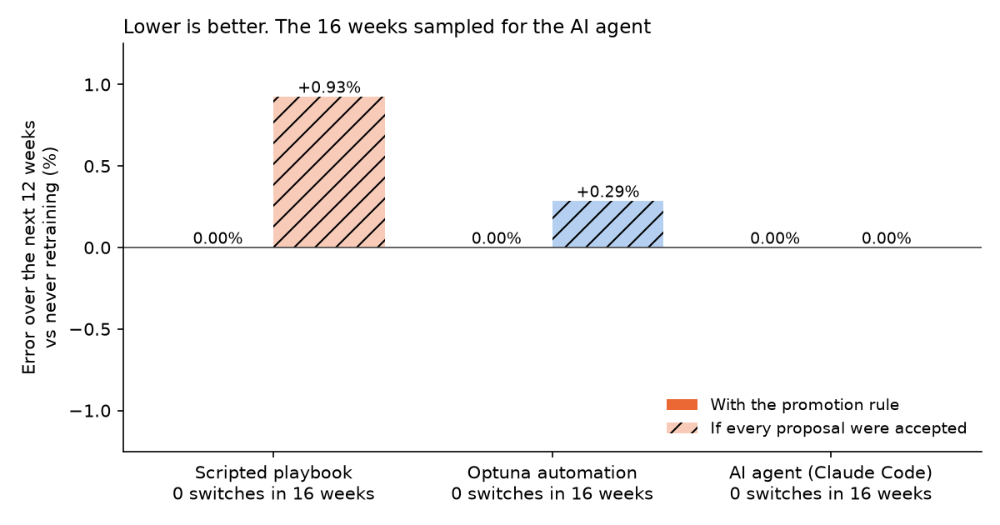
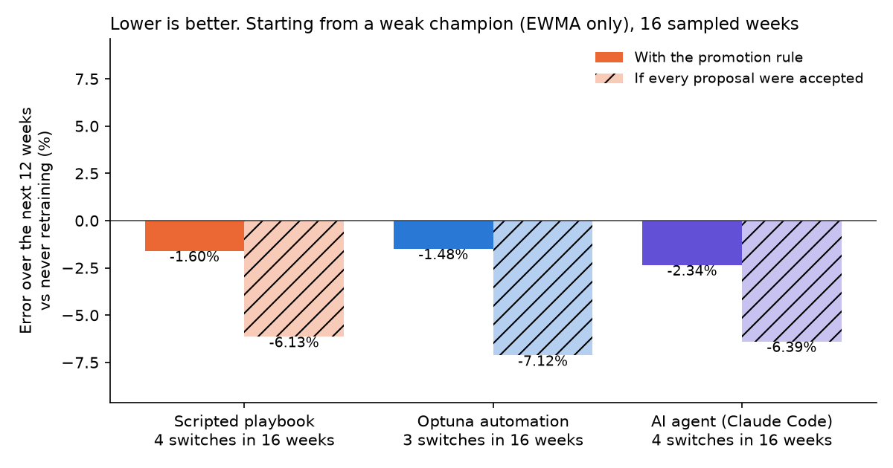
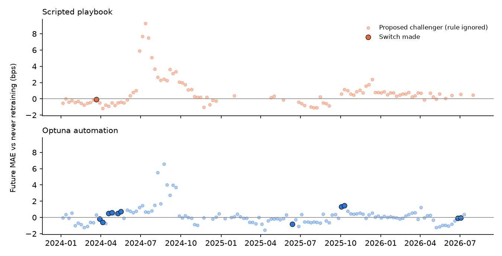

# AI model steward

Every week, new FX data arrives and the production margin model may no longer be the best
choice. This project gives that weekly review to an **AI agent**:
- it checks how the current model (the "champion") is doing and diagnoses what changed;
- it tries and tunes challengers within a fixed budget;
- it opens a pull request recommending to **keep** or **switch**, with a memo whose every
  number is checked against a ledger of the tool results.

The model it manages is the
[two-stage FX margin forecaster](https://github.com/marlondocouto2/fx-margin-forecaster)
(Project 3). The AI decides *what to try and why*. Plain Python computes every number and
enforces the rules, and a human merges.

The question: **with the same budget, does an AI agent choose better models than plain
automation, or than never retraining at all?**

## Headline results



Before any AI, the replay already gives two answers:

- **Project 3's tuned XGBoost is hard to beat.** Every week, the scripted playbook and Optuna
  automation each found a challenger that looked better in development. Accepted blindly,
  those challengers would have **raised** error over the following 12 weeks: by 1.07% for the
  playbook and 0.35% for automation.
- **The promotion rule is what protects the business.** It blocked 100 of the playbook's 101
  proposals and 115 of automation's 126. With the rule, both end up level with never
  retraining (0.00% and +0.05%).
  - Automation's 11 switches split 5 better and 6 worse.
  - In the volatile summer of 2024, blocked proposals would have added up to 9 bps of error.

**The AI agent behaved like a cautious analyst.** On 16 sampled weeks it kept the champion every
time, never spent its promotion test, and used about 6 of its 15 backtests a week. On those
same weeks:
- the playbook proposed 10 challengers, and 7 would have done worse;
- automation proposed 14, and 8 would have done worse.

All four methods ended level, because none of them switched on these weeks. So the agent
avoided the bad proposals with less compute, but this test can't show it *adding* accuracy:
there was little to gain here (see [The AI agent](#the-ai-agent)).



**With a weak champion, the agent did best.** In this second test each week starts from stage
1 only (EWMA), so there is real improvement to find:
- the agent cut error by 2.34%, against 1.60% for the playbook and 1.48% for automation;
- its 4 switches all helped, gaining 20.3 bps in total against 13.9 and 12.9;
- it used about half the backtests (7.5 a week against 10 and 14).

It's a small sample (4 switches), so read it as promising rather than proven.

The test also exposes the rule's cost. Accepting every proposal would have cut error by 6–7%
for every method, but an 8-week window gives the Diebold–Mariano test too little data, so it
blocked most real gains. The same rule that protected a strong champion is too strict for a
weak one.





*Each dot is one week's proposed challenger: its error over the next 12 weeks minus the
champion's. Below zero is better. Circled dots are weeks where the rule allowed a switch.*

## How a week works

```
status -> data-summary -> champion-report -> diagnose -> backtest x <=15 -> tune x <=2
       -> promote x <=1 (hidden window, fixed rule) -> submit memo (checked) -> pull request
```

| Guardrail | What it does |
|---|---|
| **Config space** | The agent can only choose among 4 model families (EWMA only, + Ridge, + XGBoost, + LightGBM), 6 feature groups, 4 training windows, refits every 7 or 30 days, 3 EWMA half-lives, and hyperparameters within fixed ranges (`steward/space.py`) |
| **Hidden window** | Model errors from the last 8 weeks are hidden. Development tools only score the 26 weeks before them, so the final test can't be overfit |
| **Budget** | 15 backtests, 2 tunes and 1 promotion test per week, enforced by the tools |
| **Promotion rule** | A challenger replaces the champion only if, on the hidden window, all three hold: its error is at least 1% lower; a one-sided Diebold–Mariano test (Newey–West variance, Harvey–Leybourne–Newbold correction) gives p < 0.10; and its 5% margin-at-risk band is breached on 2–9% of days |
| **Memo checks** | Every number must match a value in the cited ledger entries, cited ids must exist, "better/worse" must match the sign, and a switch needs a passed promotion test. After 3 failed tries the week is escalated, and the champion stays |
| **Pull request** | The agent proposes; CI checks that its PR only touches the champion, reports, runs and data; a human merges |

### A sample memo

From the replay, week of 2025-06-13 (Optuna automation). The full ledger is in
[`runs/replay/automation/2025-06-13/report.md`](runs/replay/automation/2025-06-13/report.md).

> **Decision: Switch.** Champion: `xgboost[fx,mk,lag] tuned all refit7 hl20`
>
> - The champion's error over the last 26 weeks was 63.14 bps vs 61.25 bps in the prior 26 weeks (+3.09%). (L01)
> - The best development candidate, xgboost[fx,mk,lag] tuned all refit7 hl20, scored 62.87 bps vs the champion's 63.14 bps (-0.43%). (L16)
> - On the hidden window it scored 43.61 bps vs the champion's 44.11 bps (p = 0.093) and passed the promotion rule. (L17)

| Id | Command | Result |
|---|---|---|
| L01 | champion-report | champion MAE last 4w 100.75, last 26w 63.14, prior 26w 61.25 bps |
| L16 | backtest | xgboost[fx,mk,lag] tuned all refit7 hl20: MAE 62.87 bps (-0.43% vs champion) |
| L17 | promote | xgboost[fx,mk,lag] tuned all refit7 hl20: 43.61 vs 44.11 bps, p = 0.093, passed |

Over the next 12 weeks, this switch lowered error from 45.87 to 45.05 bps.

## Data

- **Real:** daily FX rates from FRED (Mexican peso, Indian rupee, Brazilian real, and the broad
  dollar index), 2016 to November 2026, committed as a snapshot in `data/fred/`. FRED
  publishes them weekly, which sets the review's cadence.
- **Simulated:** the business layer from Project 3: a markup that reacts to volatility,
  settlement one or two business days later, and volumes from the Project 2 generator. It's
  simulated on a fixed calendar, so new data never changes past weeks. See `data/README.md`.

## Approach

- **Tools as a command-line interface** (`python -m steward ...`). Each prints JSON and writes
  its result to the week's ledger (`runs/<week>/ledger.jsonl`) with an id the memo must cite.
- **Interchangeable "brains"** use the same tools, budget and rule:
  - `never`: never retrain.
  - `scripted`: a fixed playbook (family → training window → half-life → refit frequency → tune).
  - `automation`: Optuna TPE over the whole config space, then tune the winner.
  - **The AI agent:** Claude Code following [`AGENT.md`](AGENT.md).
- **Replay:** each Friday from January 2024 to August 2026 is replayed from the same starting
  champion (Project 3's tuned XGBoost). The chosen model is then scored on the 12 weeks
  after the cutoff, which no tool could see.
- **The model code is reused, not copied.** Project 3 is installed from GitHub at a pinned
  commit; this repo adds feature-group selection, training windows, half-lives and the
  margin-at-risk band per config.

## Evaluation

Error of the chosen model over the 12 weeks after each cutoff (1 day ahead, all corridors),
averaged over 136 weeks (`reports/results.csv`). The dollar figure is the mean absolute error
of the daily USD margin per corridor.

| Method | Switches | Promotion tests | Future MAE (bps) | vs never | Future MAE (USD/day) | If every proposal were accepted (bps) |
|---|---|---|---|---|---|---|
| Never retrain | 0 | 0 | 52.83 | – | 375,952 | 52.83 |
| Scripted playbook | 1 | 101 | 52.83 | 0.00% | 375,958 | 53.39 (+1.07%) |
| Optuna automation | 11 | 126 | 52.85 | +0.05% | 376,136 | 53.01 (+0.35%) |

The memo's first-try pass rate was 100% for all three. That's expected, since their memos are
templated from the ledger; it becomes a real measure with the AI agent.

## The AI agent

The agent is [Claude Code](https://code.claude.com/docs) running headless with
[`AGENT.md`](AGENT.md) as its instructions.
- It may only run `python -m steward` commands and write `recommendation.json`.
- It runs on an existing Claude plan, so there's no API bill: **this project costs nothing to
  run.**
- Replayed weeks run in a sandbox whose FRED data stops at the cutoff, so it can't see later
  prices or other weeks' results.

The agent is evaluated on 16 weeks sampled evenly from calm, normal and volatile markets
(`reports/agent_weeks.txt`), compared with the baselines on the same weeks
(`reports/results_agent_weeks.csv`):

| Method | Switches | Proposals (promotion tests) | Proposals that would have done worse | Future MAE (bps) | Backtests per week |
|---|---|---|---|---|---|
| Never retrain | 0 | 0 | – | 50.32 | 0 |
| Scripted playbook | 0 | 10 | 7 | 50.32 | 11 |
| Optuna automation | 0 | 14 | 8 | 50.32 | 14 |
| AI agent | 0 | 0 | – | 50.32 | 6.25 |

What the agent did well:
- **It reads before it searches.** Each week it started with the data summary, the champion
  report and a diagnosis, then tested targeted ideas: weekly refits, shorter windows, other
  families, smaller feature sets.
- **It stopped early.** When nothing beat the champion by the 1% bar, it kept it instead of
  spending the remaining budget hunting for a lucky winner.
- **Its memos explain the decision.** They give a diagnosis, evidence per corridor and named
  risks. 12 of 16 passed the checks on the first try, the rest on the second, with no
  escalations. An example is
  [`runs/replay/agent/2024-01-26/report.md`](runs/replay/agent/2024-01-26/report.md).

Caveats:
- **Some of the caution is mine.** `AGENT.md` tells the agent that 1–2% differences are
  often luck.
- **Strict direction checks.** The check sometimes flags a claim that mixes directions (for
  example "better overall, worse for India"). The agent then rewords it.
- **No upside to find.** These weeks had nothing to gain, which is why the second test
  starts from a weak champion.

### Second test: a weak champion

The same 16 weeks, each starting from stage 1 only (`configs/weak_champion.json`, an EWMA with
no machine-learning stage). Results are in `reports/weak/results.csv`; the runs are in
`runs/replay-weak/`.

| Method | Switches | Future MAE (bps) | vs never | If every proposal were accepted | Backtests per week |
|---|---|---|---|---|---|
| Never retrain | 0 | 54.28 | – | – | 0 |
| Scripted playbook | 4 | 53.42 | −1.60% | −6.13% | 10 |
| Optuna automation | 3 | 53.48 | −1.48% | −7.12% | 14 |
| AI agent | 4 | 53.01 | **−2.34%** | −6.39% | 7.5 |

- **The agent diagnosed the weakness.** It pointed to bias and weekday patterns that a
  feature-free EWMA can't capture, and proposed a challenger every week. 15 of its 16
  proposals did better than the champion over the following 12 weeks.
- **It built leaner models.** The baselines mostly chose XGBoost with many feature groups. The
  agent picked Ridge or LightGBM on the markup and lagged-residual features, the inputs
  Project 3's SHAP analysis ranked highest. Its average proposal was about as good as the
  baselines' (50.8 bps if all accepted, against 51.0 and 50.4).
- **Its edge came from which proposals passed the rule.** Its 4 switches were the weeks with
  the largest gains. With so few switches, that edge could be luck.
- **13 of 16 memos passed on the first try**, the rest on the second. An example is
  [`runs/replay-weak/agent/2025-02-21/report.md`](runs/replay-weak/agent/2025-02-21/report.md).

Run a week yourself:

```bash
scripts/agent_week.sh 2025-07-18          # one replayed week, in a sandbox (~2 minutes)
scripts/agent_week.sh 2025-07-18 weak     # the same week, from the weak champion
python scripts/replay.py --score-only     # score it and update the results
python scripts/replay.py --scenario weak  # baselines from the weak champion, then score
```

Live, once a week after FRED's Monday release, `scripts/agent_week.sh` with no argument runs
this week's review and opens a pull request.

## How to run

```bash
python -m venv .venv && source .venv/bin/activate && pip install -r requirements.txt
python scripts/run_week.py --brain scripted --cutoff 2025-03-07   # one week, no AI (~30 s)
python scripts/replay.py                                          # all baselines, all weeks (~3 h on 8 cores)
```

`pytest` runs the guardrail tests:
- corrupting the hidden window's data changes nothing the agent can see;
- the budget is enforced;
- golden cases for the promotion rule;
- the memo checks catch planted errors;
- the scripted brain runs end to end.

On macOS, XGBoost and LightGBM need OpenMP: `brew install libomp`.

## What I'd do next

- Run the agent on more weak-champion weeks (and chained week to week) to see whether its edge
  holds with more switches.
- Let the agent propose new features as code, reviewed in the pull request, beyond the fixed
  config space.
- Make the promotion rule adapt: a longer hidden window or a sequential test, since 8 weeks
  gives the Diebold–Mariano test little power and blocked most real gains in the weak test.
- Chain the replay week to week (each week's champion carries over) to measure cumulative
  drift.
